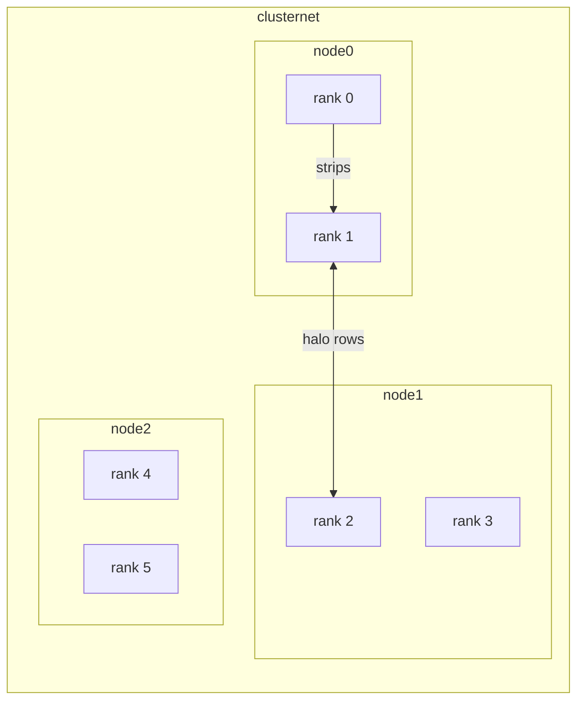

# <Your project title, e.g. "Parallel Image Filtering with MPI: halo exchange and a debugged hang">

> One sentence: what this project does and what you learned. (Write this last.)

**Author:** <your name> · **Course:** SCx61 Distributed Computing · **Week 2 — MPI point-to-point**

## 1. The problem

A 512x300 grayscale image is split into row strips, one per MPI rank. A 3x3 box blur needs the rows just above and below each strip. Without them, the rows at the strip borders come out wrong.

Answer in 3-4 sentences, in your own words:
- What is wrong with the naive decomposition (v1), and which rows show it?
- Why is a serial result (`filter_ref.py`) the right thing to compare against?

## 2. Architecture

Replace this sketch with your own. GitHub renders Mermaid diagrams in Markdown.



Add 3-4 lines: how the ranks are placed on nodes (hostfile), what rank 0 does that the others do not, and what each message contains (tags, shapes, buffers).

## 3. How to run it

This is the same layout as the course lab (`config/`, `source_code/`, `work/`). Run everything from this folder.

```bash
# 1. start the cluster (3 nodes must become "Up (healthy)")
cd config
docker compose up -d --build
docker compose ps

# 2. enter node0 as student, in the shared work folder
docker compose exec -u student -w /home/student/work node0 bash

# 3. inside node0
python3 make_test_image.py --width 512 --height 300 --out-prefix test_image
python3 -c "import numpy as np; from filter_ref import box_blur_3x3; np.save('test_image_filtered_serial.npy', box_blur_3x3(np.load('test_image.npy')))"

mpirun --hostfile hostfile -n 6 python3 img_mpi_v1_nohalo.py
python3 compare.py --candidate test_image_filtered_v1

mpirun --hostfile hostfile -n 6 python3 img_mpi_v2_halo.py
python3 compare.py --candidate test_image_filtered_v2
```

Tested on: <OS, Docker Desktop version, date>. Test from a fresh clone before you publish.

The failing program (`v3`) and the scripts that trigger the hang come from the course Break Kit and are **not** in this repository. The incident is documented in [INCIDENT.md](INCIDENT.md) with the relevant code excerpts.

## 4. Results

| Version | Differing pixels vs serial reference | Differing rows |
|---|---|---|
| v1: no halo | <number from compare.py> | <rows from compare.py> |
| v2: halo exchange (`Sendrecv`) | <number> | none |

Add a **before / after** figure of the seam rows (v1 vs v2), saved with Pillow (already installed on the nodes), in `results/`.

Do not claim speedups unless you measured them on your machine, and say what the machine is.

## 5. The incident

Short summary and a link to [INCIDENT.md](INCIDENT.md): what hung, how you proved why, how you verified the fix.

## 6. AI usage

Link to [AI_LOG.md](AI_LOG.md). Two sentences: where the AI helped, and one claim that was wrong or only hid the symptom.

## 7. What I would do next

2-3 bullets.

## Credits

SCx61 Distributed Computing: Norhan Saber (Teaching Assistant), Scientific Computing Department, Faculty of Computers and Artificial Intelligence, Benha University.
